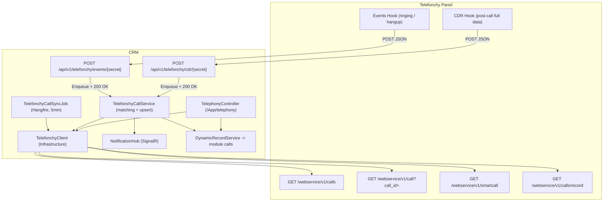

# اتصال CRM به تلفنچی (Telefonchy)

## خلاصه معماری



نقشه endpointهای تلفنچی که استفاده می‌کنیم (base: `https://panel.telefonchy.com/webservice/v1`، هدر `webservice-token`):
- `GET /calls` - لیست تماس با `service_id`, `page`, `sort`, `date_from`, `date_to`, `type`, `status`, `exten`
- `GET /call?call_id={cuid}` - جزئیات یک تماس (شماره کامل، `time_talk`, `file_id`, `status`)
- `GET /smartcall?service_id&exten&to` - Click-to-Call، برمی‌گرداند `request_id`
- `GET /smartcall/status/{request_id}` - وضعیت: `requested/queued/routing/dialing/answered/failed`
- `GET /calls/record?file_id&cuid` - استریم فایل ضبط مکالمه
- وب‌هوک «ارسال ایونت تماس»: تلفنچی به آدرس ما `POST` می‌کند با `data.event` = `ringing` یا `hangup`
- وب‌هوک «ارسال اطلاعات تماس (CDR)»: پس از اتمام هر تماس، اطلاعات کامل تماس (مدت، وضعیت، شماره‌ها، `file_id`) `POST` می‌شود

دو وب‌هوک بالا در پنل تلفنچی دو فیلد «آدرس فراخوانی» جدا دارند و به دو endpoint جدا در CRM وصل می‌شوند.

## فاز ۰ - تنظیمات و زیرساخت

فیلدهای جدید در [src/Crm.Infrastructure/Services/TenantIntegrationService.cs](src/Crm.Infrastructure/Services/TenantIntegrationService.cs) داخل `IntegrationConfig` (کنار `VoipEnabled` فعلی، خط ۳۰-۳۱):

```csharp
// تلفنچی
public bool TelefonchyEnabled { get; set; }
public string? TelefonchyBaseUrl { get; set; }        // پیش‌فرض https://panel.telefonchy.com/webservice/v1
public string? TelefonchyToken { get; set; }          // webservice-token
public string? TelefonchyServiceId { get; set; }
public string? TelefonchyHookSecret { get; set; }     // در URL وب‌هوک، هنگام فعال‌سازی تولید می‌شود
public bool TelefonchySyncEnabled { get; set; } = true;
public bool TelefonchyAutoLogCalls { get; set; } = true;
public bool TelefonchyRecordingEnabled { get; set; } = true;
public string? TelefonchyDefaultExten { get; set; }   // داخلی پیش‌فرض برای Click-to-Call
public bool HasTelefonchy => TelefonchyEnabled
    && !string.IsNullOrWhiteSpace(TelefonchyToken)
    && !string.IsNullOrWhiteSpace(TelefonchyServiceId);
```

- کارت جدید «تلفنچی» در [src/Crm.Web/Areas/App/Views/Integrations/Index.cshtml](src/Crm.Web/Areas/App/Views/Integrations/Index.cshtml) (جای کارت فعلی «VoIP سانترال»، خطوط ۶۲-۷۰): توکن به‌صورت `type=password`، نمایش آدرس وب‌هوک آماده کپی، دکمه «تست اتصال».
- `POST /App/integrations/telefonchy/test` در [src/Crm.Web/Areas/App/Controllers/IntegrationsController.cs](src/Crm.Web/Areas/App/Controllers/IntegrationsController.cs): یک `GET /calls?page=1` می‌زند و تعداد تماس‌ها را برمی‌گرداند.
- نگاشت کارشناس به داخلی: ستون `TelefonchyExtension` روی [src/Crm.Infrastructure/Identity/CrmUser.cs](src/Crm.Infrastructure/Identity/CrmUser.cs) + مایگریشن (الگوی نام‌گذاری `{yyyyMMddHHmmss}_TelefonchyIntegration.cs`) + یک input در فرم ویرایش کاربر.

## فاز ۱ - کلاینت API

فایل جدید `src/Crm.Infrastructure/Services/TelefonchyClient.cs` با دقیقاً همان الگوی `HttpSmsSender` در [src/Crm.Infrastructure/Services/IntegrationAdapters.cs](src/Crm.Infrastructure/Services/IntegrationAdapters.cs) (تزریق `TenantIntegrationService` + `IHttpClientFactory` + `ILogger`):

```csharp
Task<TelefonchyCallPage?> GetCallsAsync(int page = 1, DateTime? fromUtc = null, string sort = "DESC", CancellationToken ct = default);
Task<TelefonchyCall?> GetCallAsync(string callId, CancellationToken ct = default);
Task<TelefonchySmartCallResult?> SmartCallAsync(string exten, string to, CancellationToken ct = default);
Task<TelefonchySmartCallResult?> GetSmartCallStatusAsync(string requestId, CancellationToken ct = default);
Task<(Stream Content, string ContentType, string FileName)?> GetRecordingAsync(string fileId, string cuid, CancellationToken ct = default);
```

نکات پیاده‌سازی:
- `date_from` / `date_to` در تلفنچی **شمسی** با فرمت `Y/m/d 00:00` هستند. چون [src/Crm.Web/Services/PersianDateHelper.cs](src/Crm.Web/Services/PersianDateHelper.cs) در لایه Web است، یک متد کوچک `ToJalaliParam(DateTime)` با `System.Globalization.PersianCalendar` داخل خود کلاینت می‌نویسیم.
- توکن هرگز به مرورگر نمی‌رود؛ همه فراخوانی‌ها سمت سرور.
- تایم‌اوت ۲۰ ثانیه، لاگ خطا بدون چاپ توکن، هیچ استثنایی به بالا پرت نمی‌شود (خروجی `null`).
- ثبت در DI در [src/Crm.Web/Program.cs](src/Crm.Web/Program.cs) کنار خط ۷۰-۷۱ (`AddScoped<TenantIntegrationService>` / `AddScoped<AccountingPushJob>`).

## فاز ۲ - فیلدهای تلفنی روی ماژول calls

ماژول `calls` در [src/Crm.Infrastructure/Services/SalesModuleSeeder.cs](src/Crm.Infrastructure/Services/SalesModuleSeeder.cs) خطوط ۱۱۰-۱۲۲ فعلاً این فیلدها را دارد: `name`, `contact`, `direction`, `callAt`, `durationMinutes`, `result`, `description`.

مهم: `EnsureModuleAsync` (خط ۳۴۶-۳۴۷) اگر ماژول موجود باشد **زودتر return می‌کند** و فیلد جدید اضافه نمی‌کند. پس یک متد idempotent جدا لازم است:

```csharp
// SalesModuleSeeder: بعد از EnsureSeededAsync صدا زده می‌شود
private async Task EnsureCallTelephonyFieldsAsync(int tenantId)
// فیلدهای جدید روی ماژول calls اگر نبودند:
//   cuid            Text     showInList:false  (شناسه یکتای تماس تلفنچی - کلید idempotency)
//   phoneNumber     Phone                      (شماره طرف مقابل، کامل)
//   extension       Text     showInList:false  (داخلی کارشناس)
//   waitSeconds     Number   showInList:false
//   talkSeconds     Number   showInList:false
//   recordingFileId Text     showInList:false
//   lead            Lookup -> leads, showInList:false
```

نگاشت داده تلفنچی به فیلدهای CRM:
- `type` -> `direction` (`incoming` / `outgoing`)
- `status` -> `result`: `ANSWERED` به `answered`، `NO ANSWER` به `noanswer`، `BUSY` به `busy`، بقیه به `followup`
- `started_at` -> `callAt`، `time_talk` -> `talkSeconds` و `Math.Ceiling(time_talk/60)` -> `durationMinutes`
- `call_source` یا `call_dest` (هرکدام شماره بیرونی است) -> `phoneNumber`
- `cuid` -> `cuid`، `file_id` -> `recordingFileId`، `exten.number` -> `extension`

برای سرعت جست‌وجوی idempotency، یک ایندکس expression روی `Records` در همان مایگریشن:

```sql
CREATE INDEX IF NOT EXISTS "IX_Records_CustomData_cuid"
ON "Records" (("CustomData" ->> 'cuid'));
```

## فاز ۳ - تطبیق شماره و سرویس ثبت تماس

فایل جدید `src/Crm.Infrastructure/Services/TelefonchyCallService.cs` - قلب یکپارچگی:

- `NormalizePhone(string)`: حذف فاصله/خط تیره، `+98`/`0098` به `0`، ساخت «۹ رقم آخر» به‌عنوان کلید تطبیق.
- `MatchAsync(phone)`: جست‌وجوی جدول `Records` با `CustomData ->> 'mobile'` و `->> 'phone'` روی ماژول‌های `contacts` و `leads` (فیلدهای موجود: `contacts.mobile`, `contacts.phone`, `leads.phone` در [SalesModuleSeeder.cs](src/Crm.Infrastructure/Services/SalesModuleSeeder.cs) خطوط ۳۳ و ۶۵-۶۶). امروز endpoint فعلی `voip/incoming` فقط `contacts.mobile` را با تطبیق دقیق چک می‌کند ([ApiV1Controller.cs](src/Crm.Web/Controllers/Api/ApiV1Controller.cs) خط ۲۳۷-۲۴۶) - این به تطبیق بر پایه ۹ رقم آخر روی چند فیلد و چند ماژول ارتقا می‌یابد.
- `MatchMaskedAsync(masked)`: مخصوص وب‌هوک. payload تلفنچی شماره را ماسک‌شده می‌دهد (`"912****975"`)؛ ماسک به regex تبدیل می‌شود (`^912.{4}975$`) و روی شماره‌های نرمال‌شده تطبیق داده می‌شود. اگر بیش از یک نتیجه بود، پاپ‌آپ به‌صورت «چند مخاطب محتمل» نمایش داده می‌شود و شماره کامل از `GET /call?call_id={cuid}` گرفته می‌شود تا قطعی شود.
- `UpsertCallAsync(TelefonchyCall)`: اگر رکوردی با همان `cuid` بود آپدیت، وگرنه ساخت با `DynamicRecordService`.
- `NotifyIncomingAsync(...)`: ساخت `Notification` + ارسال به گروه `user-{userId}` روی [src/Crm.Web/Hubs/NotificationHub.cs](src/Crm.Web/Hubs/NotificationHub.cs). گیرنده: کاربری که `TelefonchyExtension` او با `dest` تماس ورودی می‌خورد؛ در نبود نگاشت، همه کاربران فعال Tenant (رفتار فعلی).

## فاز ۴ - دو وب‌هوک ورودی

دو endpoint جدید در [src/Crm.Web/Controllers/Api/ApiV1Controller.cs](src/Crm.Web/Controllers/Api/ApiV1Controller.cs):

```
POST /api/v1/telefonchy/events/{secret}     -> «ارسال ایونت تماس» (ringing / hangup)
POST /api/v1/telefonchy/cdr/{secret}        -> «ارسال اطلاعات تماس (CDR)» پس از اتمام تماس
```

آدرس‌های تصمیم‌گرفته‌شده برای ثبت در پنل تلفنچی (دامنه `bamacrm.ir`، secret مشترک `b3340f2049364b8591105e65c36a9380`):

```
CDR:    https://bamacrm.ir/api/v1/telefonchy/cdr/b3340f2049364b8591105e65c36a9380
Events: https://bamacrm.ir/api/v1/telefonchy/events/b3340f2049364b8591105e65c36a9380
```

همین secret به‌عنوان مقدار پیش‌فرض `TelefonchyHookSecret` برای Tenant اصلی ست می‌شود تا آدرس ثبت‌شده در پنل بدون تغییر کار کند؛ در صفحه یکپارچگی‌ها قابل بازتولید است.

رفتار مشترک هر دو:
- بدون `X-Api-Key` (تلفنچی هدر سفارشی نمی‌فرستد). احراز دو لایه: `{secret}` در مسیر + مقایسه `webservice_token` موجود در بدنه با توکن ذخیره‌شده همان Tenant.
- Tenant با جست‌وجوی `TelefonchyHookSecret` در ستون jsonb `Tenants.Settings` با `IgnoreQueryFilters()` پیدا می‌شود. یک secret مشترک برای هر دو hook، چون هر دو از یک سرویس تلفنچی می‌آیند.
- **فوراً `200 OK`** برگردانده می‌شود و پردازش با `BackgroundJob.Enqueue` به Hangfire می‌رود (مستندات تلفنچی روی این تأکید دارد).
- بدنه خام payload در جدول لاگ ساده (یا `Notification`-مانند) ذخیره می‌شود تا در دیباگ اولیه بتوان ساختار واقعی CDR را دید؛ CDR ممکن است ساختارش با ایونت تفاوت داشته باشد و باید با داده واقعی تثبیت شود.

اختصاصی `events`:
- `event == "ringing"`: تطبیق ماسک‌آگاه، پاپ‌آپ SignalR، و در صورت روشن بودن `TelefonchyAutoLogCalls` ساخت رکورد تماس با `result = followup`.
- `event == "hangup"`: علامت‌گذاری پایان تماس و بستن پاپ‌آپ. تکمیل جزئیات به CDR واگذار می‌شود؛ اگر CDR در بازه‌ای نرسید، `GET /call?call_id={cuid}` به‌عنوان fallback زده می‌شود.

اختصاصی `cdr`:
- منبع اصلی داده کامل تماس: مدت مکالمه، وضعیت نهایی، شماره کامل (غیرماسک) و `file_id` فایل ضبط.
- `UpsertCallAsync` بر پایه `cuid` رکورد ساخته‌شده در `ringing` را کامل می‌کند؛ اگر رکوردی نبود (مثلاً وب‌هوک ایونت غیرفعال باشد) رکورد را از صفر می‌سازد. به همین دلیل CDR به‌تنهایی هم برای ثبت کامل تماس‌ها کافی است.

endpoint فعلی `POST /api/v1/voip/incoming` حفظ می‌شود (سازگاری با سانترال‌های دیگر) ولی درونش به `TelefonchyCallService` منتقل می‌شود تا منطق تطبیق یکی باشد.

سمت کلاینت، بلوک `connection.on("incomingCall", ...)` در [src/Crm.Web/Views/Shared/_PanelLayout.cshtml](src/Crm.Web/Views/Shared/_PanelLayout.cshtml) (خطوط ۲۳۶-۲۸۰) توسعه می‌یابد: نام مخاطب، شماره، نوع تماس، و دو دکمه «باز کردن پرونده مخاطب» و «ثبت مخاطب جدید با این شماره». رویداد جدید `callStatus` هم برای بازخورد Click-to-Call اضافه می‌شود.

## فاز ۵ - سینک دوره‌ای (پشتیبان و تاریخچه)

جاب جدید `TelefonchyCallSyncJob` در Infrastructure، ثبت به‌صورت recurring در [src/Crm.Web/Program.cs](src/Crm.Web/Program.cs) کنار جاب‌های موجود (خطوط ۱۵۵-۱۷۶):

```csharp
app.Services.GetRequiredService<IRecurringJobManager>().AddOrUpdate<TelefonchyCallSyncJob>(
    "telefonchy-call-sync",
    job => job.SyncAllTenantsAsync(),
    "*/5 * * * *");
```

- برای هر Tenant با `HasTelefonchy && TelefonchySyncEnabled`: صفحه‌به‌صفحه `GET /calls` با `date_from` = آخرین سینک منهای ۱ ساعت (پنجره همپوشان)، توقف وقتی همه cuidهای صفحه از قبل موجود بودند یا `paginator.current == paginator.last`.
- زمان آخرین سینک در همان بخش `integrations` تنظیمات Tenant ذخیره می‌شود.
- تماس‌های Click-to-Call ثبت‌شده در فاز ۶ با همین سینک تکمیل می‌شوند (مدت، وضعیت، فایل صوت).
- اولین اجرا برای هر Tenant: import تاریخچه با محدودیت (مثلاً ۳۰ روز اخیر) به‌عنوان یک `BackgroundJob` جداگانه از دکمه «سینک اولیه» در صفحه یکپارچگی‌ها.

## فاز ۶ - تماس سریع (Click-to-Call)

کنترلر جدید `src/Crm.Web/Areas/App/Controllers/TelephonyController.cs` با ارث‌بری از `AppControllerBase`:

```
POST /App/telephony/call            { moduleName, recordId, phone }
GET  /App/telephony/call-status     ?requestId=...
GET  /App/telephony/recording/{callRecordId}
GET  /App/telephony/report
```

- `Call`: داخلی از `CrmUser.TelefonchyExtension` کاربر جاری (fallback به `TelefonchyDefaultExten`)؛ اگر داخلی ست نشده باشد پیام فارسی روشن برمی‌گردد. سپس `SmartCallAsync` و ساخت فوری رکورد تماس با `direction=outgoing`, `result=followup`, لینک به مخاطب/سرنخ، و ذخیره `request_id`.
- `CallStatus`: polling سمت مرورگر هر ۳ ثانیه تا حداکثر ۶۰ ثانیه (طبق توصیه مستندات)، وقتی `cuid` آمد روی رکورد تماس ذخیره می‌شود.
- دکمه تماس در [src/Crm.Web/Areas/App/Views/Records/Details.cshtml](src/Crm.Web/Areas/App/Views/Records/Details.cshtml) داخل `<div class="crm-rd-actions">` (خطوط ۱۱۲-۱۳۱، همان‌جا که دکمه «تبدیل سرنخ» شرطی است) - فقط وقتی `HasTelefonchy` و ماژول `contacts`/`leads` و فیلد شماره پر باشد. دکمه پس از کلیک موقتاً disable می‌شود تا تماس تکراری ثبت نشود.
- دکمه تماس در ردیف‌های جدول [_CrmDataTable.cshtml](src/Crm.Web/Areas/App/Views/Shared/_CrmDataTable.cshtml) و کارت کانبان به‌صورت اختیاری در همان فاز.

## فاز ۷ - پخش فایل ضبط مکالمه

- `GET /App/telephony/recording/{callRecordId}`: رکورد تماس را می‌خواند، `recordingFileId` و `cuid` را برمی‌دارد، `GET /calls/record` را سمت سرور صدا می‌زند و خروجی را به‌صورت `FileStreamResult` با `enableRangeProcessing: true` پاس می‌دهد (پروکسی؛ توکن به مرورگر نمی‌رسد).
- کش اختیاری روی دیسک با همان قرارداد پیوست‌ها در [RecordsController.cs](src/Crm.Web/Areas/App/Controllers/RecordsController.cs) خطوط ۲۰۹۹-۲۱۱۷: `wwwroot/uploads/records/{tenantId}/calls/{recordId}/{fileId}.mp3` و ثبت یک `Attachment` تا در تب پیوست‌ها هم دیده شود.
- در `Details.cshtml` ماژول `calls`، اگر `recordingFileId` پر بود یک `<audio controls>` با `src` همان endpoint رندر می‌شود.
- کنترل دسترسی: همان چک دسترسی رکورد ماژول `calls` (RBAC موجود) - فایل صوت بدون دسترسی به رکورد قابل دریافت نیست.

## فاز ۸ - گزارش تماس

- بخش تماس‌ها در [src/Crm.Web/Areas/App/Controllers/DashboardController.cs](src/Crm.Web/Areas/App/Controllers/DashboardController.cs) (`widgets-data`, خطوط ۱۲۳-۲۳۳): تعداد تماس امروز/هفته، نسبت ورودی به خروجی، بی‌پاسخ‌ها، میانگین مدت مکالمه، و Top ۵ کارشناس بر اساس داخلی.
- رندر با ApexCharts در `@section Scripts` فایل [src/Crm.Web/Areas/App/Views/Dashboard/Index.cshtml](src/Crm.Web/Areas/App/Views/Dashboard/Index.cshtml).
- صفحه `GET /App/telephony/report` با فیلتر بازه تاریخ شمسی، نوع تماس، داخلی و کارشناس - و خروجی Excel با `WordExportService`/الگوی export موجود.

## امنیت

- توکن تلفنچی فقط در `Tenants.Settings` (jsonb) و فقط سمت سرور استفاده می‌شود؛ در UI به‌صورت ماسک‌شده نمایش داده می‌شود و در لاگ چاپ نمی‌شود.
- وب‌هوک: secret در مسیر + تطبیق `webservice_token` + rate limit مشابه `RateLimitPerMinute` موجود در [ApiV1Controller.cs](src/Crm.Web/Controllers/Api/ApiV1Controller.cs) خط ۲۲.
- endpoint وب‌هوک فقط `application/json` و حجم محدود می‌پذیرد؛ در نبود Tenant منطبق `404` بدون افشای جزئیات.
- فایل صوت و لیست تماس‌ها همه از پروکسی سرور با چک RBAC عبور می‌کنند.

## ریسک‌ها و مواردی که در حین کار باید با پنل واقعی تست شود

- ماسک بودن `src`/`dest` در وب‌هوک ایونت: تطبیق ماسک‌آگاه پیاده می‌شود، ولی شماره قطعی از CDR یا `GET /call` می‌آید. اگر هیچ‌کدام شماره کامل ندادند، برای نمایش نام مخاطب به سینک `GET /calls` (که شماره کامل دارد) تکیه می‌کنیم و پاپ‌آپ در حالت چندگزینه‌ای می‌ماند.
- ساختار دقیق payload وب‌هوک CDR در مستندات عمومی تلفنچی نیامده است؛ اولین کار پس از ثبت آدرس، لاگ کردن یک payload واقعی و تثبیق مدل بر اساس آن است. تا آن زمان مدل CDR را سازگار با خروجی `GET /calls` فرض می‌کنیم.
- `GET /call` پارامتر `call_id` می‌گیرد و در خروجی `/calls` هم `id` هست هم `cuid`؛ باید با داده واقعی مشخص شود کدام قابل قبول است. کلاینت اول `cuid` را می‌فرستد و در صورت خطا `id` را.
- فعال‌سازی وب‌هوک نیازمند ثبت آدرس در پنل تلفنچی است و آدرس CRM باید عمومی و HTTPS باشد؛ در محیط توسعه با tunnel یا فقط با مسیر polling تست می‌شود.
- Click-to-Call فقط با داخلی آنلاین کار می‌کند؛ پیام خطای فارسی روشن برای حالت آفلاین لازم است.
- فرمت تاریخ شمسی در `date_from`/`date_to` و اختلاف منطقه زمانی سرور با تلفنچی؛ پنجره سینک همپوشان (۱ ساعت) این ریسک را می‌پوشاند.
